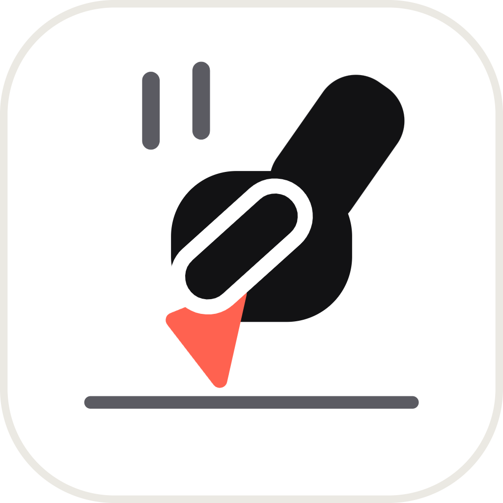
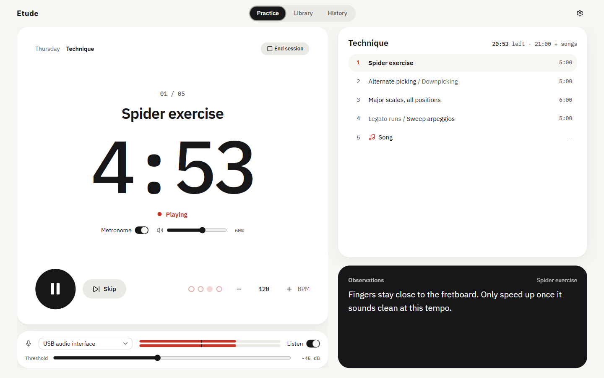
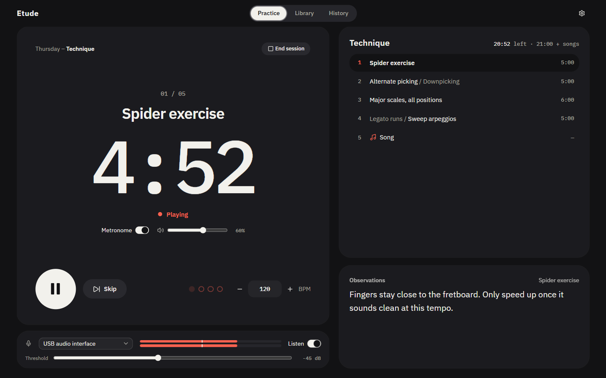
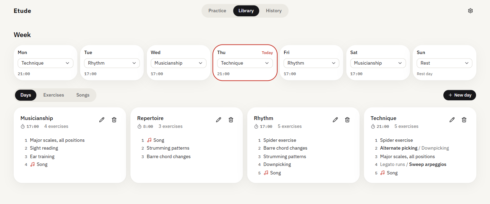
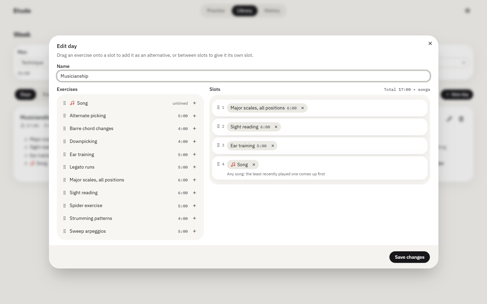
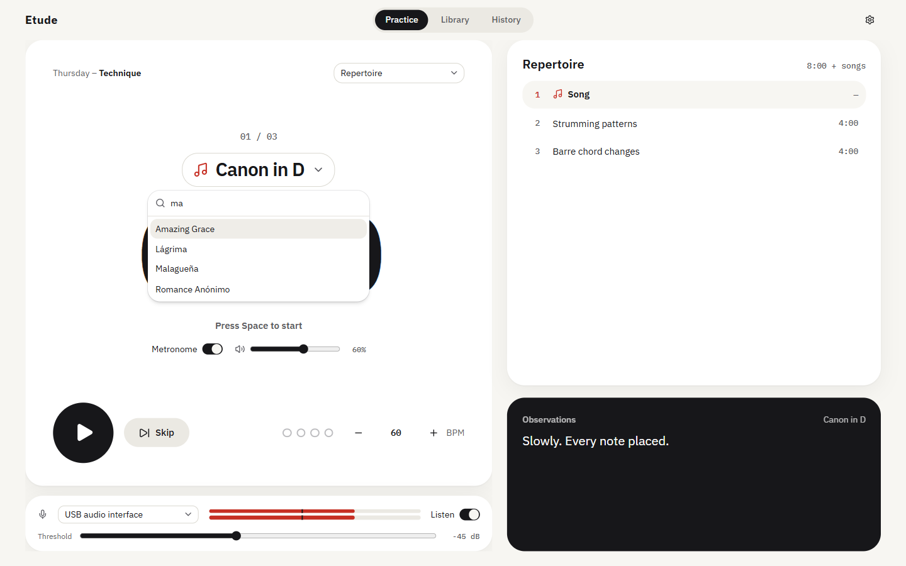
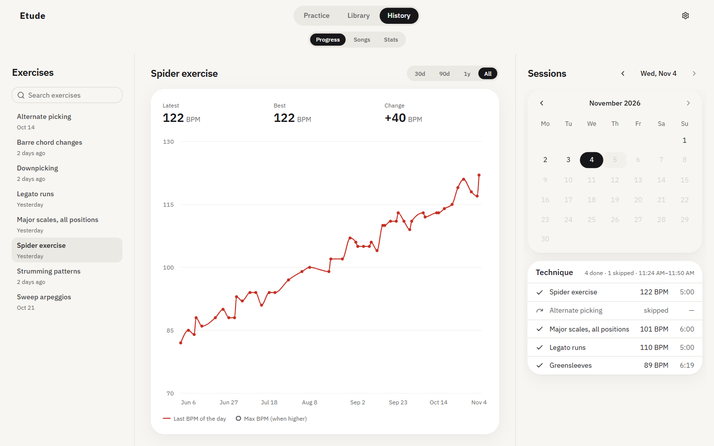
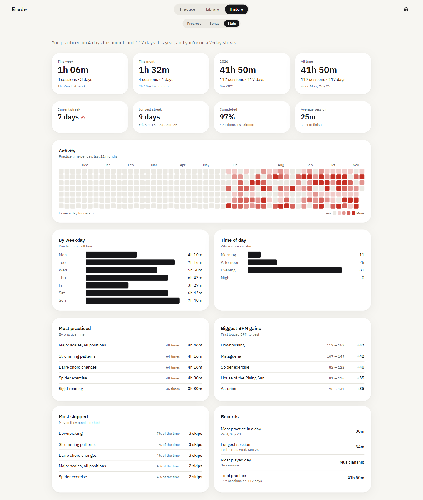

<p align="center">
  
</p>

<h1 align="center">Etude</h1>

<p align="center">A desktop practice timer for musicians. The clock only runs while you're actually playing.</p>



I wanted something that runs my practice routine for me: what to play today, for how long, and at what tempo, without losing count when I stop to look at my hands or check my phone. Etude listens through your microphone, so the timer pauses when you go quiet and picks up again when you start playing.

It logs every session, so you can also see whether the tempos are going up. Everything stays in a local database on your computer, with no account.

## What it does

### Practice

- **Sound-activated clock.** The clock runs while the mic hears something above a threshold you set, and stops 5 seconds after you go quiet. You can turn this off with the Listen switch, and it also just runs if there's no mic.
- **Runs the routine.** It counts down each exercise, plays a chime when time is up and queues the next one. Space starts and pauses.
- **Metronome.** It clicks at the exercise's BPM, with its own volume and on/off switch right under the clock. Pausing silences it too.
- **Tempo logging.** Nudge the BPM mid-exercise and that's the tempo that gets logged.
- **Notes per exercise.** Your observations for the current exercise stay on screen while you play.
- **Dark mode**, for the late sessions.



### Plan

- **Exercises and songs.** Exercises have a set duration. Songs are untimed: the clock counts up until you hit Done.
- **Days.** A day is an ordered list of slots, built by dragging things around.
- **Alternatives.** Put several exercises in one slot and it comes up with the one you've done least recently.
- **Song slots.** A song slot rotates through every song you have, so new ones join automatically. You can also search for a specific one.
- **Week.** Assign a day to each weekday and the right routine is waiting when you open the app.



<table>
  <tr>
    <td></td>
    <td></td>
  </tr>
</table>

### Track

- **Progress.** A BPM chart for each exercise and song, next to a calendar of what you played each day.
- **Stats.** Totals by week, month and year, streaks, an activity heatmap, your biggest BPM gains and the exercises you keep skipping.



<details>
<summary>The full stats page</summary>



</details>

<sub>The data in these screenshots is made up.</sub>

## Building it

You'll need [Node.js](https://nodejs.org) and npm. I build it with Node 24 on Windows.

```bash
git clone https://github.com/FranciscoTurro/etude.git
cd etude
npm install
npm run dev
```

`npm install` also downloads Electron and sets up `better-sqlite3`, a native module. If that step fails, you're probably missing a C++ build toolchain.

To package it:

```bash
npm run build:win     # installer, in dist/
npm run build:unpack  # no installer, just a runnable folder in dist/
```

`build:mac` and `build:linux` exist too, but I only use and test it on Windows, so expect some rough edges there. The Windows build isn't code signed, so SmartScreen may warn you the first time you run it.

Run `npm run typecheck` to check types and `npm run format` to format the code.

## Your data

Everything lives in one SQLite file, `etude.db`, in Electron's user data folder:

| OS      | Location                              |
| ------- | ------------------------------------- |
| Windows | `%APPDATA%\etude`                     |
| macOS   | `~/Library/Application Support/etude` |
| Linux   | `~/.config/etude`                     |

Settings has Export and Import buttons, which save or restore all of it as a single file. That's the way to move to another computer.

To try the app without touching your real data, point it at another folder by setting `ETUDE_DATA_DIR` before launching.

## How it's built

Electron, React 19, TypeScript, Tailwind CSS, [Base UI](https://base-ui.com) and [shadcn/ui](https://ui.shadcn.com), [better-sqlite3](https://github.com/WiseLibs/better-sqlite3) and [Recharts](https://recharts.org), bundled with [electron-vite](https://electron-vite.org).

```
src/
  main/       Electron main process: window, IPC, and the database (queries and migrations)
  preload/    The API the UI gets to call
  renderer/   The React app: practice, library and history screens
  shared/     Types and validation used by both sides
```

The mic level and the metronome both use the Web Audio API. Metronome clicks are scheduled on the audio clock rather than with timers, so the beat shouldn't drift.
